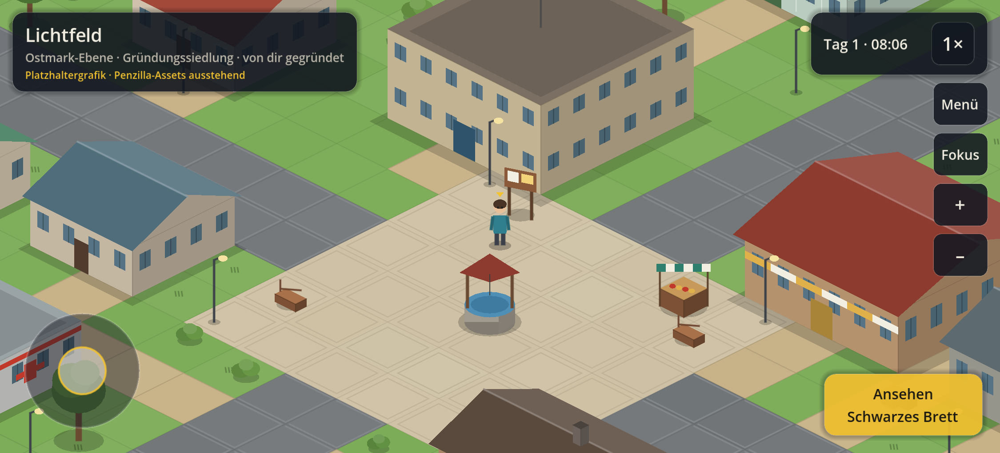

# WORLDS

**Lebendige, persistente Gesellschafts-, Wirtschafts- und Zivilisationssimulation**
2.5D-isometrische Lebens-, Aufbau- und Gesellschaftssimulation · Godot 4.7.2 · GDScript · Web / iOS Safari / PWA

> **Projektstatus: Phase 1 – World Foundation** (zur Abnahme durch den Projektinhaber).
> Spätere Phasen sind dokumentiert, aber **nicht implementiert**.

## Was Phase 1 enthält (implementiert)

| Bereich | Stand |
|---|---|
| Godot-Projekt | Godot 4.7.2, GL Compatibility Renderer, GDScript |
| Leerer Planet | Planet startet ohne Siedlungen (`data/world/genesis.json`); Siedlungen entstehen nur durch Gründung eines Spielers (`WorldState`), keine NPC-only-Siedlungen |
| Deine Siedlung „Lichtfeld“ | Beim ersten Start von dir gegründet aus der Vorlage `data/settlement_templates/founding_basic.json`, 28×28 Kacheln, 16 Gebäude, Platz, Brunnen, Straßen, Felder, Teich, Vegetation |
| Darstellung | Isometrisch 2:1, Y-Sortierung, Kollisionen, Tag/Nacht-Tönung, Laternen-Licht bei Nacht |
| Spielfigur | Tastatur (WASD/Pfeile), virtueller Joystick, Tippen/Klicken = dorthin gehen, 8 Blickrichtungen |
| Kamera | Folgen, Ziehen zum Verschieben, Pinch-/Mausrad-Zoom, Grenzen, Zentrieren |
| Interaktion | Gebäude/Objekte ansehen, Schwarzes Brett, Ausruhen (Zeitsprung), Brunnen |
| HUD | Siedlungsname, Region, Spielzeit & Geschwindigkeit, Kamera-Buttons, Interaktions-Taste, Menü, Hinweise, FPS-Anzeige |
| Web | Export ohne Threads (kompatibel mit GitHub Pages & iOS Safari), PWA (Manifest, Service Worker, Icons) |
| CI/CD | GitHub Actions: Import → 55 automatische Tests → Web-Export → GitHub Pages (von `main`) |



**Wichtig – Grafik:** Die fünf gekauften Penzilla-Pakete konnten noch **nicht** heruntergeladen werden (siehe [docs/ASSET_INVENTORY.md](docs/ASSET_INVENTORY.md)). Alle Gebäude, Objekte und die Spielfigur sind deshalb **klar gekennzeichnete Platzhalter** (prozedural gezeichnet, Hinweis im HUD). Über `data/asset_manifest.json` werden die echten Penzilla-Grafiken später ohne Codeänderung eingesetzt.

## Starten

**Im Browser (nach Deployment):** `https://rxplxcxd.github.io/Claude-Worlds/` – siehe [BUILD_AND_DEPLOYMENT](docs/BUILD_AND_DEPLOYMENT.md) (Pages muss einmalig aktiviert werden, Deployment erfolgt von `main`).

**Lokal (Editor):** Godot 4.7.2 öffnen → `project.godot` importieren → F5.

**Lokal (Kommandozeile):**
```bash
godot --headless --path . --import                         # Import
godot --headless --path . res://tests/test_runner.tscn      # Tests
godot --headless --path . --export-release "Web" build/web/index.html
```

## Steuerung

| | Touch (iPhone) | Desktop |
|---|---|---|
| Gehen | Joystick unten links | WASD / Pfeiltasten |
| Dorthin gehen / Objekt benutzen | Tippen | Linksklick |
| Kamera verschieben | Ein Finger ziehen | Maus ziehen |
| Zoom | Zwei Finger | Mausrad, `+` / `-` |
| Interagieren | Gelbe Taste unten rechts | `E` / Enter / Leertaste |
| Kamera zentrieren | „Fokus“ | `C` |
| Menü / FPS | „Menü“ | `Esc` / `F3` |

## Projektstruktur

```
project.godot, export_presets.cfg, icon.svg
scenes/      main/, settlement/, player/          (schlanke Szenen)
scripts/     core/ geography/ world/ settlement/ buildings/ player/
             camera/ interaction/ ui/ persistence/
data/        asset_manifest.json, world/genesis.json, settlement_templates/founding_basic.json
assets/      (Ziel für Penzilla-Assets, siehe ASSET_INVENTORY)
web/icons/   PWA-/Home-Screen-Icons
tests/       Headless-Testsuite
tools/       Icon-Rendering, lokaler Browser-Smoke-Test
docs/        Design- und Technikdokumentation
.github/workflows/web.yml
```

## Dokumentation

[ARCHITECTURE](docs/ARCHITECTURE.md) · [ROADMAP](docs/ROADMAP.md) · [ASSET_INVENTORY](docs/ASSET_INVENTORY.md) · [BUILD_AND_DEPLOYMENT](docs/BUILD_AND_DEPLOYMENT.md) · [PERFORMANCE](docs/PERFORMANCE.md) · [WORLD_DESIGN](docs/WORLD_DESIGN.md) · [GEOGRAPHY_SYSTEM](docs/GEOGRAPHY_SYSTEM.md) · [SETTLEMENT_SYSTEM](docs/SETTLEMENT_SYSTEM.md) · [PLAYER_SYSTEM](docs/PLAYER_SYSTEM.md) · [NPC_SYSTEM](docs/NPC_SYSTEM.md) · [SOCIAL_SYSTEM](docs/SOCIAL_SYSTEM.md) · [ECONOMY_SYSTEM](docs/ECONOMY_SYSTEM.md) · [TRADE_AND_LOGISTICS](docs/TRADE_AND_LOGISTICS.md) · [POLITICAL_SYSTEM](docs/POLITICAL_SYSTEM.md) · [COUNCIL_SYSTEM](docs/COUNCIL_SYSTEM.md) · [MIGRATION_SYSTEM](docs/MIGRATION_SYSTEM.md) · [CONTRACT_SYSTEM](docs/CONTRACT_SYSTEM.md) · [FIREBASE_SCHEMA](docs/FIREBASE_SCHEMA.md) · [GAMEPLAY_DESIGN](docs/GAMEPLAY_DESIGN.md) · [CHANGELOG](CHANGELOG.md)

Jedes Dokument kennzeichnet Inhalte als **[IMPLEMENTIERT]**, **[GEPLANT]** oder **[OFFEN]**.
